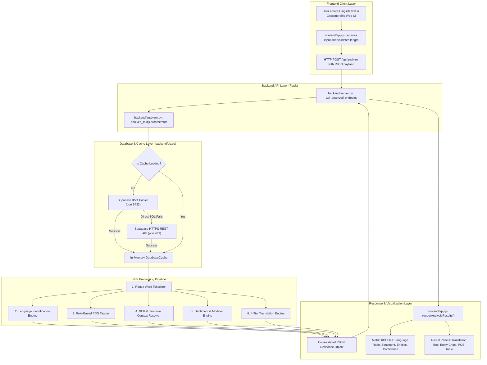
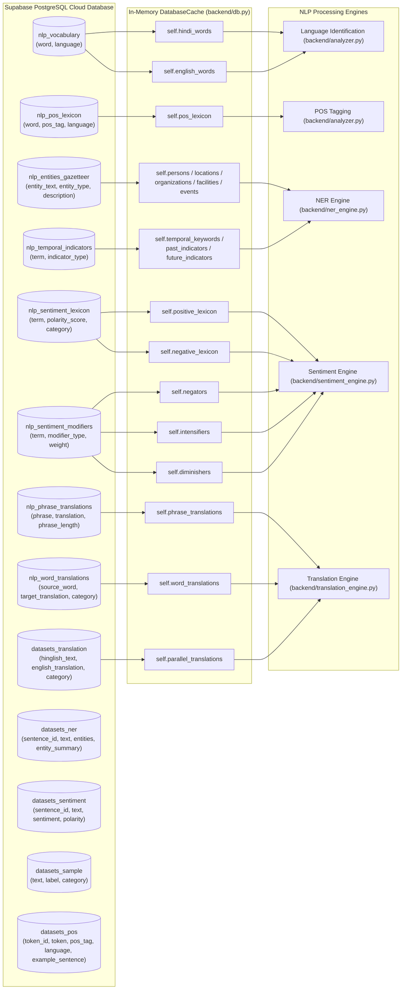
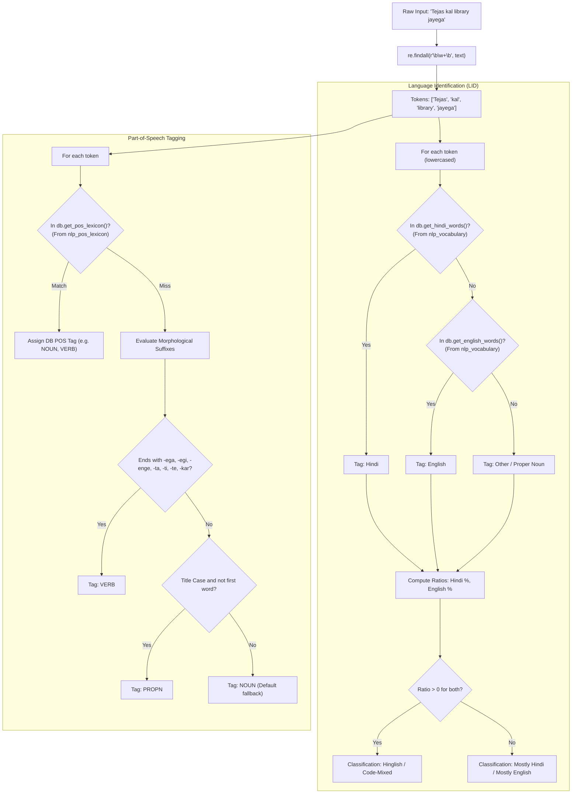
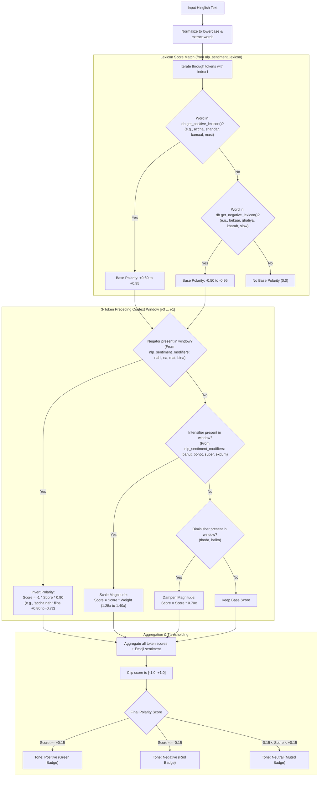
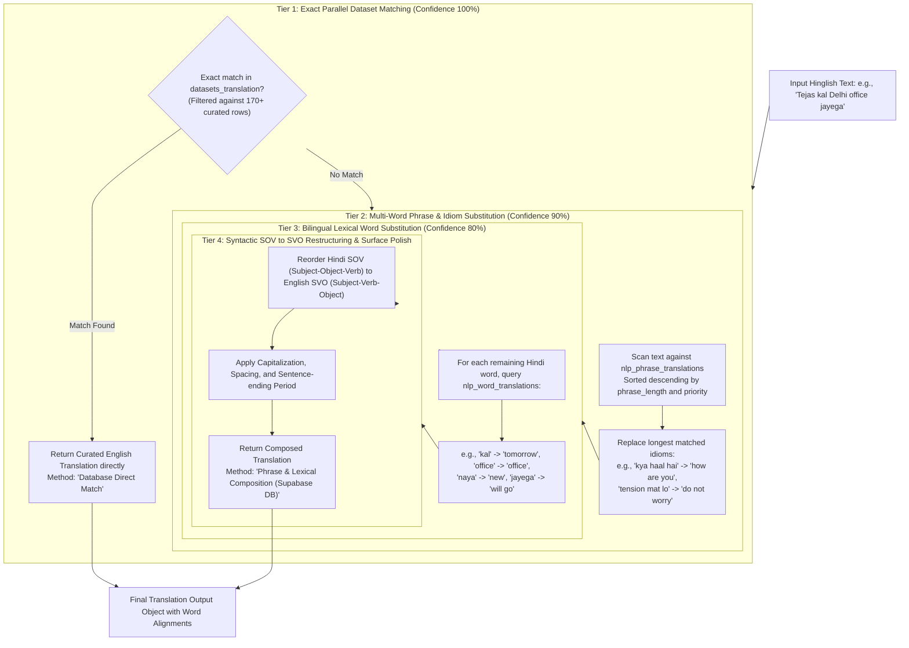
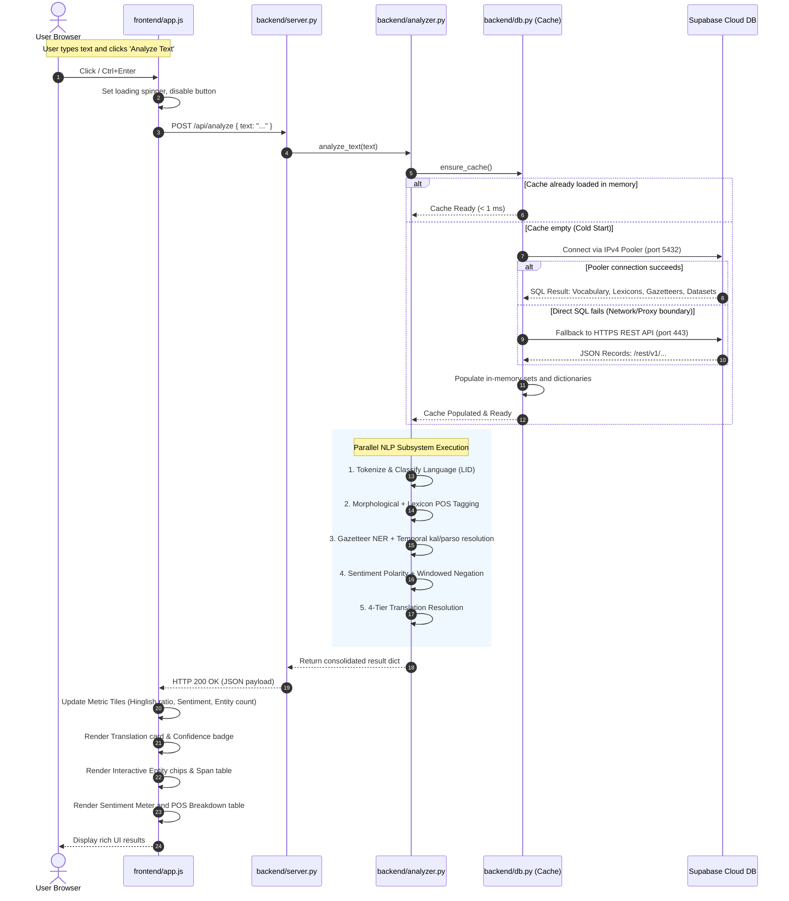

# Hinglish NLP Studio: End-to-End Workflow Diagrams, Architecture & LLM Prompts

This document provides complete, exhaustive workflow diagrams, dataflow breakdowns, database table mappings, and production-grade LLM prompts for generating diagrams across any tool (Mermaid, PlantUML, Graphviz DOT, and ASCII/Unicode).

---

## Table of Contents
1. [End-to-End System Workflow Diagram](#1-end-to-end-system-workflow-diagram)
2. [Database Schema & Table Integration Map](#2-database-schema--table-integration-map)
3. [Deep-Dive Subsystem Pipelines](#3-deep-dive-subsystem-pipelines)
   - [Pipeline A: Tokenization, Language ID & POS Tagging](#pipeline-a-tokenization-language-id--pos-tagging)
   - [Pipeline B: Named Entity Recognition & Temporal Resolution](#pipeline-b-named-entity-recognition--temporal-resolution)
   - [Pipeline C: Sentiment Analysis & Negation Windowing](#pipeline-c-sentiment-analysis--negation-windowing)
   - [Pipeline D: 4-Tier Translation Engine](#pipeline-d-4-tier-translation-engine)
4. [Client-Server-Database Sequence Diagram](#4-client-server-database-sequence-diagram)
5. [Complete LLM Prompts to Generate Workflow Diagrams](#5-complete-llm-prompts-to-generate-workflow-diagrams)
   - [Prompt 1: Full System Dataflow Prompt](#prompt-1-full-system-dataflow-for-plantuml--mermaid)
   - [Prompt 2: Database Table Fetch & Cache Architecture Prompt](#prompt-2-database-table-fetch--cache-architecture)
   - [Prompt 3: Multi-Tier Translation Decision Tree Prompt](#prompt-3-multi-tier-translation-decision-tree)
   - [Prompt 4: Entity-Relationship & Schema Architecture Prompt](#prompt-4-entity-relationship--schema-architecture)

---

## 1. End-to-End System Workflow Diagram



---

## 2. Database Schema & Table Integration Map

This diagram specifies **every database table**, the exact columns retrieved, and how each module in memory utilizes that table.



---

## 3. Deep-Dive Subsystem Pipelines

### Pipeline A: Tokenization, Language ID & POS Tagging



---

### Pipeline B: Named Entity Recognition & Temporal Resolution

```mermaid
flowchart TD
    TOKENS["Input Tokens + Contextual Sentence"] --> GAZETTEER_SCAN["Scan 1-gram, 2-gram, 3-gram against Gazetteer"]

    subgraph GazetteerCheck["Gazetteer Matching (from nlp_entities_gazetteer)"]
        GAZETTEER_SCAN --> CHK_P{"In db.get_persons()?\n(e.g., Tejas, Rohan, Parth)"}
        CHK_P -- Yes --> E_PER["Entity: PERSON"]
        
        CHK_P -- No --> CHK_L{"In db.get_locations()?\n(e.g., Delhi, Bangalore, Goa)"}
        CHK_L -- Yes --> E_LOC["Entity: LOCATION"]
        
        CHK_L -- No --> CHK_O{"In db.get_organizations()?\n(e.g., Google, Microsoft, TCS)"}
        CHK_O -- Yes --> E_ORG["Entity: ORGANIZATION"]
        
        CHK_O -- No --> CHK_F{"In db.get_facilities()?\n(e.g., office, library, airport)"}
        CHK_F -- Yes --> E_FAC["Entity: FACILITY"]
        
        CHK_F -- No --> CHK_E{"In db.get_events()?\n(e.g., hackathon, IPL, Diwali)"}
        CHK_E -- Yes --> E_EVT["Entity: EVENT"]
    end

    subgraph TemporalResolution["Contextual Temporal Resolution (from nlp_temporal_indicators)"]
        GAZETTEER_SCAN --> CHK_T{"Token in db.get_temporal_keywords()?\n(e.g., 'kal', 'aaj', 'parso')"}
        CHK_T -- Yes --> WORD_KAL{"Word == 'kal'?"}
        
        WORD_KAL -- Yes --> VERB_INSPECT["Inspect Surrounding Verb Conjugation"]
        VERB_INSPECT --> TENSE{"Verb ends in -ega, -egi, -enge\nor includes 'jayega' / 'karega'?"}
        TENSE -- Yes --> FUT["Assign: DATE_TIME (Tomorrow / Future Context)"]
        TENSE -- No --> PAST{"Verb ends in -tha, -thi, -the\nor includes 'gaya' / 'kiya'?"}
        PAST -- Yes --> PST["Assign: DATE_TIME (Yesterday / Past Context)"]
        PAST -- Ambiguous --> DEF_TIME["Assign: DATE_TIME (Relative Context)"]
        
        WORD_KAL -- No --> STD_TIME["Assign: DATE_TIME from indicator category"]
    end

    E_PER & E_LOC & E_ORG & E_FAC & E_EVT & FUT & PST & STD_TIME --> MERGE["Deduplicate Spans & Build Entity Chip Summary"]
```



---

### Pipeline C: Sentiment Analysis & Negation Windowing



---

### Pipeline D: 4-Tier Translation Engine



---

## 4. Client-Server-Database Sequence Diagram



---

## 5. Complete LLM Prompts to Generate Workflow Diagrams

Copy and paste the exact prompts below into any LLM (ChatGPT, Claude, Gemini, DeepSeek) to generate new diagrams in your preferred format.

---

### Prompt 1: Full System Dataflow (For PlantUML / Mermaid)

```text
Act as a Principal System Architect and NLP Systems Engineer. 
Generate a comprehensive, production-grade PlantUML / Mermaid architecture diagram showing the exact end-to-end dataflow of a Hinglish (Hindi-English code-mixed) Natural Language Processing suite.

The system consists of:
1. Client Layer: Glassmorphic Web frontend (app.js) sending JSON payload via HTTP POST /api/analyze.
2. Server Layer: Python Flask server (backend/server.py) delegating to an NLP orchestrator (backend/analyzer.py).
3. Data Layer: Supabase PostgreSQL database holding 13 tables:
   - datasets_ner (160 rows), datasets_sentiment (154 rows), datasets_translation (170 rows), datasets_sample (90 rows), datasets_pos (125 rows)
   - nlp_vocabulary, nlp_pos_lexicon, nlp_sentiment_lexicon, nlp_sentiment_modifiers, nlp_entities_gazetteer, nlp_temporal_indicators, nlp_phrase_translations, nlp_word_translations
4. Connection Resilience: Dual-connectivity strategy using an IPv4 Pooler on port 5432 with automatic fallback to HTTPS REST API on port 443 when direct SQL is blocked.
5. In-Memory Cache: DatabaseCache loaded on startup for sub-millisecond token lookups.
6. Processing Pipelines:
   - Word Tokenizer (Regex)
   - Language Identification Engine (Hindi/English ratio calculator)
   - POS Tagger (Lexicon + Suffix rules for -ega, -egi, -enge, -kar)
   - NER Engine (Gazetteer lookup + context-aware temporal resolution for 'kal')
   - Sentiment Analyzer (Lexicon score + 3-token window negation inversion + intensifier scaling)
   - 4-Tier Translation Engine (Exact DB Match -> Phrase/Idiom Replacement -> Lexical Translation -> SOV to SVO Restructuring)
7. Response Layer: JSON response updating 4 Metric KPI tiles, translation cards, interactive entity chips, and token tables.

Please output the complete diagram code with clear grouping, labels, and swimlanes.
```

---

### Prompt 2: Database Table Fetch & Cache Architecture

```text
Act as a Database Architect.
Create a detailed Mermaid flowchart that maps out the exact relationship between database tables in Supabase and the in-memory cache structures of an NLP application:

Tables to map:
1. 'nlp_vocabulary' (columns: word, language) -> Populates 'self.hindi_words' and 'self.english_words' sets. Used by: Language Identification Engine.
2. 'nlp_pos_lexicon' (columns: word, pos_tag, language) -> Populates 'self.pos_lexicon' dictionary. Used by: POS Tagger.
3. 'nlp_sentiment_lexicon' (columns: term, polarity_score, category) -> Populates 'self.positive_lexicon', 'self.negative_lexicon', 'self.emoji_sentiment'. Used by: Sentiment Analyzer.
4. 'nlp_sentiment_modifiers' (columns: term, modifier_type, weight) -> Populates 'self.negators', 'self.intensifiers', 'self.diminishers'. Used by: Sentiment Negation Windowing.
5. 'nlp_entities_gazetteer' (columns: entity_text, entity_type, description) -> Populates sets for PERSON, LOCATION, ORGANIZATION, FACILITY, EVENT. Used by: NER Engine.
6. 'nlp_temporal_indicators' (columns: term, indicator_type) -> Populates past/future indicators. Used by: Contextual 'kal' (Yesterday vs Tomorrow) Resolver.
7. 'nlp_phrase_translations' (columns: phrase, translation, phrase_length, priority) -> Populates 'self.phrase_translations'. Used by: Tier 2 Idiom Substitution.
8. 'nlp_word_translations' (columns: source_word, target_translation, category) -> Populates 'self.word_translations'. Used by: Tier 3 Lexical Substitution.
9. 'datasets_translation' (columns: hinglish_text, english_translation, category) -> Populates 'self.parallel_translations'. Used by: Tier 1 Direct Dataset Match.

Show the flow from SQL/REST query -> memory cache attribute -> NLP feature function. Ensure syntax is valid Mermaid.
```

---

### Prompt 3: Multi-Tier Translation Decision Tree

```text
Act as a Senior Computational Linguist and AI Engineer.
Create a comprehensive Decision Tree flowchart in Mermaid format illustrating the 4-tier translation algorithm used for converting Hinglish (code-mixed Hindi-English) into Standard English:

Rules to visualize:
- Step 1: Input text is sanitized and trimmed.
- Step 2 (Tier 1): Search 'datasets_translation' (170 parallel sentences). If exact match found, return immediately with Confidence = 100% and Method = 'Database Direct Match'.
- Step 3 (Tier 2): If no exact match, scan input for multi-word idioms and colloquial phrases from 'nlp_phrase_translations' (e.g. 'kya chal raha hai', 'tension mat lo', 'chai peene'). Replace matched spans with their English equivalents sorted by phrase length.
- Step 4 (Tier 3): For any remaining un-translated Hindi tokens, query 'nlp_word_translations' for direct bilingual dictionary mapping (e.g. 'kal' -> 'tomorrow', 'dost' -> 'friend').
- Step 5 (Tier 4): Syntactic Reordering. Detect Hindi SOV (Subject-Object-Verb) patterns using auxiliary verb markers and reorder into English SVO (Subject-Verb-Object).
- Step 6: Surface cleaning: Fix spacing around punctuation, ensure initial letter capitalization, and append appropriate terminating punctuation. Output with Confidence = 85% and Method = 'Phrase & Lexical Composition (Supabase DB)'.

Provide the complete Mermaid diagram code.
```

---

### Prompt 4: Entity-Relationship & Schema Architecture

```text
Act as a PostgreSQL Database Administrator.
Generate a complete Mermaid Entity-Relationship (ER) diagram representing the relational schema for a Hinglish NLP Suite hosted on Supabase:

Include all the following tables with their data types and primary/unique keys:
1. datasets_ner (id PK, sentence_id INT, text TEXT, entities JSONB, entity_summary TEXT, created_at TIMESTAMPTZ)
2. datasets_sentiment (id PK, sentence_id INT, text TEXT, sentiment VARCHAR, polarity FLOAT, sentiment_keywords TEXT, created_at TIMESTAMPTZ)
3. datasets_translation (id PK, sentence_id INT, hinglish_text TEXT, english_translation TEXT, category VARCHAR, created_at TIMESTAMPTZ)
4. datasets_sample (id PK, text TEXT, label VARCHAR, category VARCHAR, created_at TIMESTAMPTZ)
5. datasets_pos (id PK, token_id INT UNIQUE, token VARCHAR, pos_tag VARCHAR, language VARCHAR, example_sentence TEXT, created_at TIMESTAMPTZ)
6. nlp_vocabulary (id PK, word VARCHAR, language VARCHAR, created_at TIMESTAMPTZ) [UNIQUE(word, language)]
7. nlp_pos_lexicon (id PK, word VARCHAR UNIQUE, pos_tag VARCHAR, language VARCHAR, created_at TIMESTAMPTZ)
8. nlp_sentiment_lexicon (id PK, term VARCHAR UNIQUE, polarity_score FLOAT, category VARCHAR, created_at TIMESTAMPTZ)
9. nlp_sentiment_modifiers (id PK, term VARCHAR UNIQUE, modifier_type VARCHAR, weight FLOAT, created_at TIMESTAMPTZ)
10. nlp_entities_gazetteer (id PK, entity_text VARCHAR, entity_type VARCHAR, description TEXT, created_at TIMESTAMPTZ) [UNIQUE(entity_text, entity_type)]
11. nlp_temporal_indicators (id PK, term VARCHAR, indicator_type VARCHAR, created_at TIMESTAMPTZ) [UNIQUE(term, indicator_type)]
12. nlp_phrase_translations (id PK, phrase VARCHAR UNIQUE, translation TEXT, phrase_length INT, priority INT, created_at TIMESTAMPTZ)
13. nlp_word_translations (id PK, source_word VARCHAR UNIQUE, target_translation TEXT, category VARCHAR, created_at TIMESTAMPTZ)

Provide valid Mermaid 'erDiagram' syntax with descriptions.
```

